# Particle Swarm Optimization for Cosmological Parameter Estimation

A graduate Optimization Theory project applying a from-scratch **particle swarm optimization (PSO)** implementation to cosmological parameter fitting with 31 cosmic-chronometer measurements of the Hubble expansion rate, $H(z)$.

The project follows the optimizer itself as the parameter space grows from flat $\Lambda$CDM to non-flat $\Lambda$CDM and then to flat and non-flat XCDM. The emphasis is on swarm dynamics, convergence, objective-function structure, and model comparison rather than on posterior sampling.

## How the swarm finds the best fit

The optimization mechanics are documented explicitly in [`METHOD.md`](METHOD.md) and reproduced in [`00_pso_mechanics.ipynb`](notebooks/00_pso_mechanics.ipynb). Each particle represents a candidate cosmology, keeps a personal-best position (`pbest`), and is also attracted toward the best position found by the entire swarm (`gbest`).

The personal and collective memory terms can be seen directly in the production swarm. Arrows from the current particle positions toward `pbest` and `gbest` show the cognitive and social components of the PSO update.

<p align="center">
  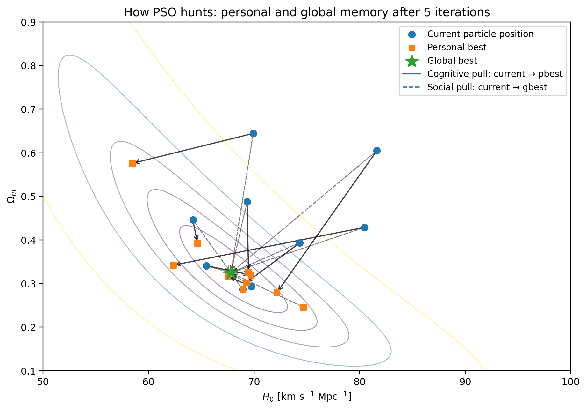
</p>

The iteration sequence below follows the actual production swarm on the same $\chi^2(H_0,\Omega_m)$ landscape. The initially broad population contracts into the low-$\chi^2$ valley as information about better solutions propagates through the swarm.

<p align="center">
  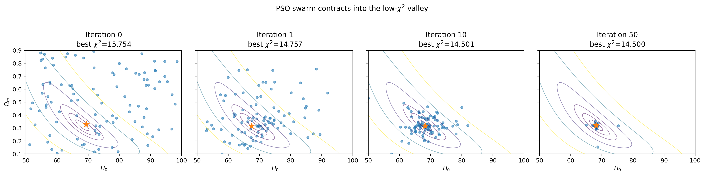
</p>

The global-best trajectory records how the best-known cosmology moves through parameter space, while the convergence curve verifies that the best objective value decreases and then stabilizes.

<p align="center">
  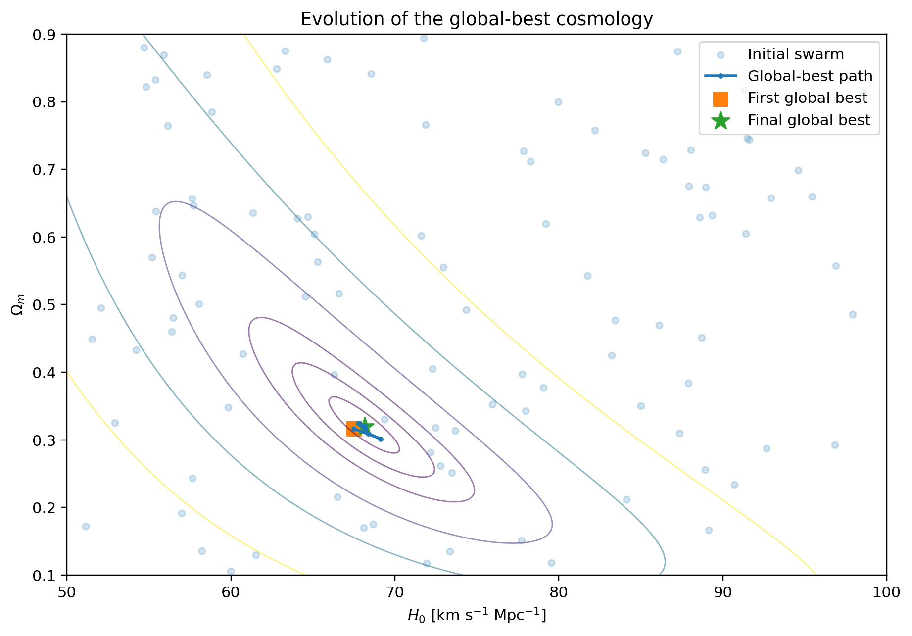
  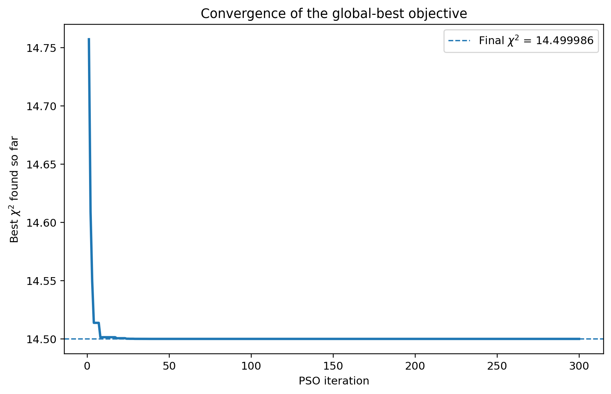
</p>

<p align="center">
  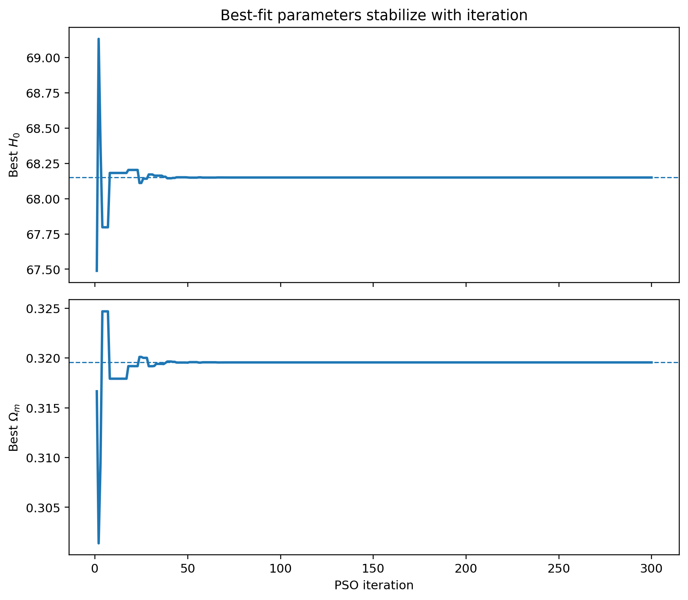
</p>

A five-particle hand calculation from the project presentation is also reproduced in the method notebook. It uses the same observational $\chi^2$ function as the full run and shows explicitly how rescoring after one update changes `pbest` and `gbest`.

## Optimization dynamics

The flat $\Lambda$CDM problem provides a two-dimensional objective surface in $(H_0,\Omega_m)$, making the PSO behavior directly visible. The figures below show the swarm moving across the $\chi^2$ landscape and converging toward the global best position.

<p align="center">
  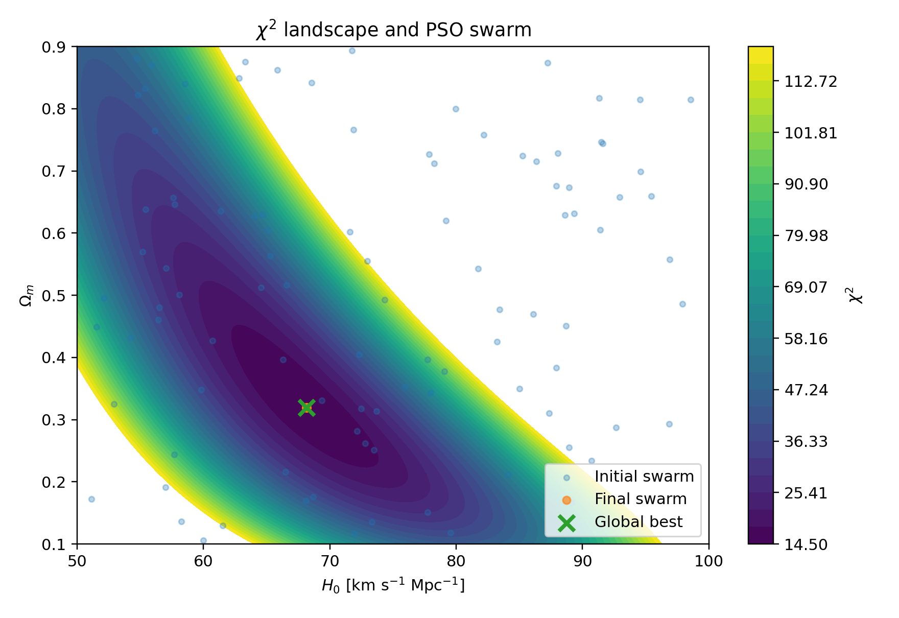
  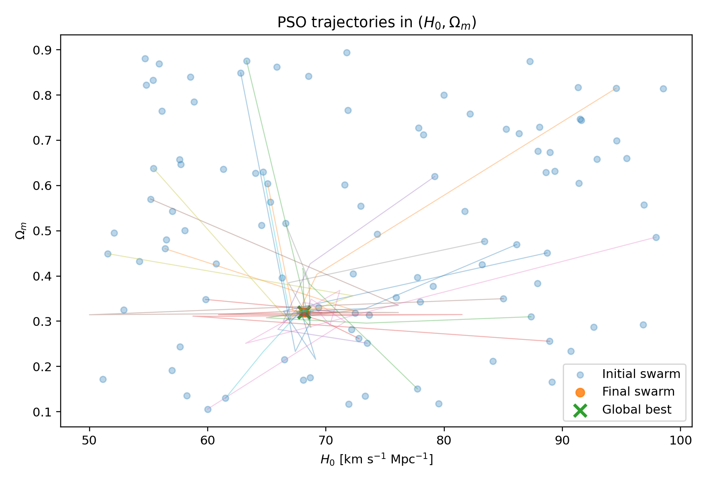
</p>

The production flat-$\Lambda$CDM run uses 100 particles, 300 iterations, inertia $\omega=0.72$, cognitive/social coefficients $c_1=c_2=1.49$, and random seed 42. It converges to

$$
H_0 = 68.149916\;\mathrm{km\,s^{-1}\,Mpc^{-1}},\qquad
\Omega_m = 0.319555,
$$

with $\chi^2_{\min}=14.499986$ for the 31 $H(z)$ measurements.

<p align="center">
  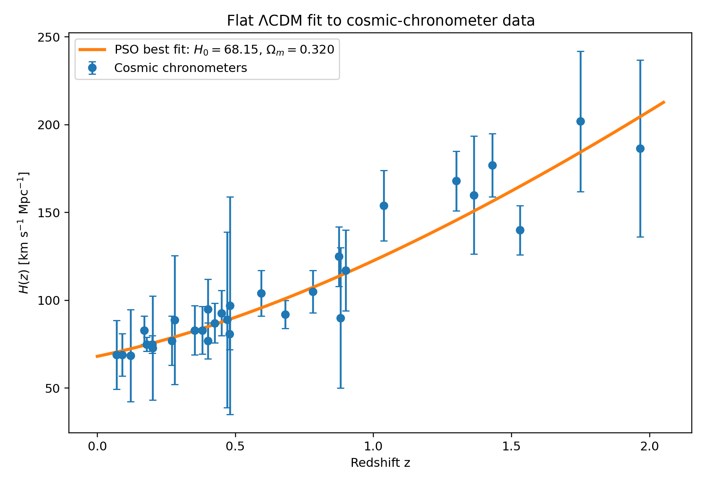
</p>

## Curvature and dark-energy extensions

The same optimizer is then applied to progressively larger cosmological parameter spaces.

### Flat versus non-flat $\Lambda$CDM

| Model | $H_0$ | $\Omega_m$ | $\Omega_k$ | $\chi^2_{\min}$ | AIC | BIC |
|---|---:|---:|---:|---:|---:|---:|
| Flat $\Lambda$CDM | 68.149916 | 0.319555 | 0 | 14.499986 | 18.499986 | 21.367960 |
| Non-flat $\Lambda$CDM | 68.998731 | 0.359749 | -0.125924 | 14.461770 | 20.461770 | 24.763731 |

Allowing curvature lowers the raw minimum by only $\Delta\chi^2=-0.038216$. The added parameter is therefore not favored by the information criteria: $\Delta\mathrm{AIC}=1.961784$ and $\Delta\mathrm{BIC}=3.395771$ relative to flat $\Lambda$CDM.

<p align="center">
  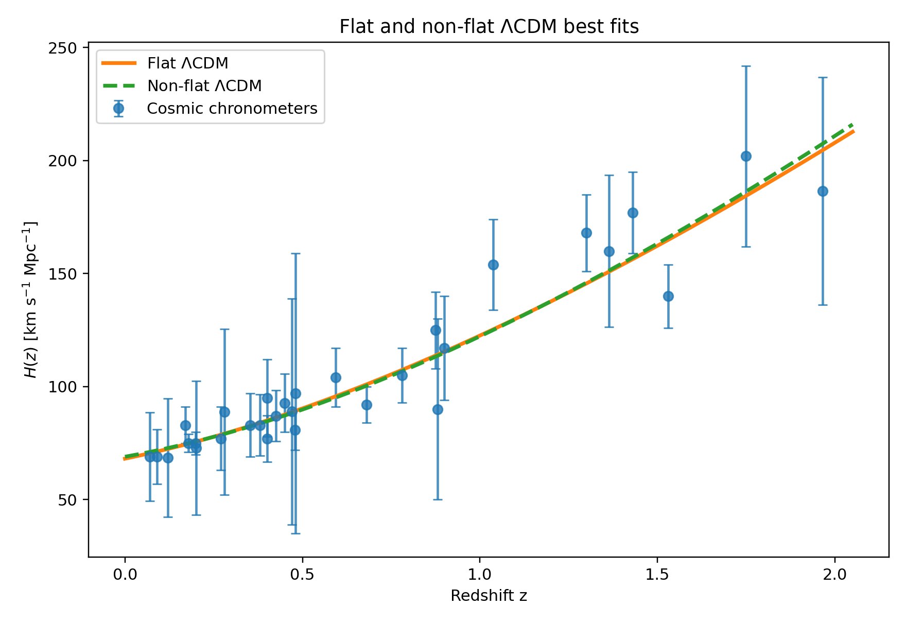
  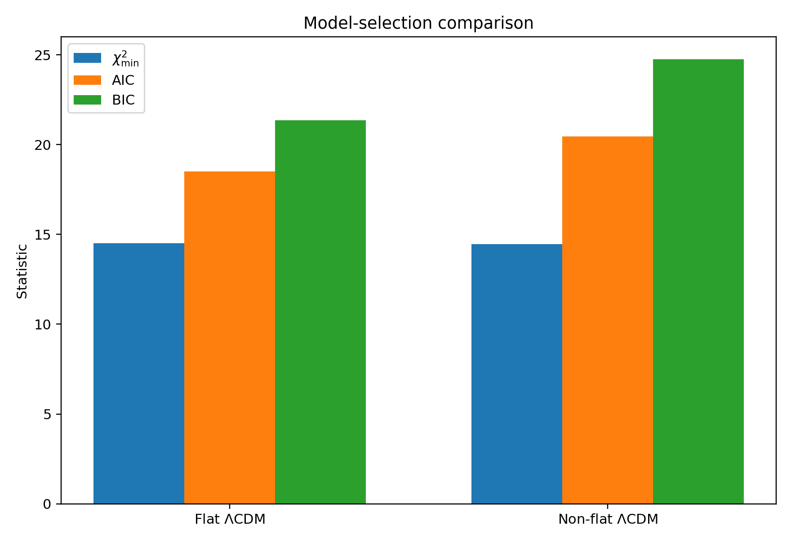
</p>

### XCDM

XCDM adds a constant dark-energy equation-of-state parameter $w$. The larger parameter spaces reach slightly lower $\chi^2$ values, but the information criteria continue to favor the simpler flat $\Lambda$CDM model for this data set.

| Model | $H_0$ | $\Omega_m$ | $\Omega_k$ | $w$ | $\chi^2_{\min}$ | AIC | BIC |
|---|---:|---:|---:|---:|---:|---:|---:|
| Flat $\Lambda$CDM | 68.149916 | 0.319555 | 0 | -1 | 14.499986 | 18.499986 | 21.367960 |
| Flat XCDM | 70.820175 | 0.322310 | 0 | -1.249724 | 14.360644 | 20.360644 | 24.662605 |
| Non-flat XCDM | 75.362696 | 0.169184 | 0.324478 | -2.307880 | 14.102573 | 22.102573 | 27.838522 |

<p align="center">
  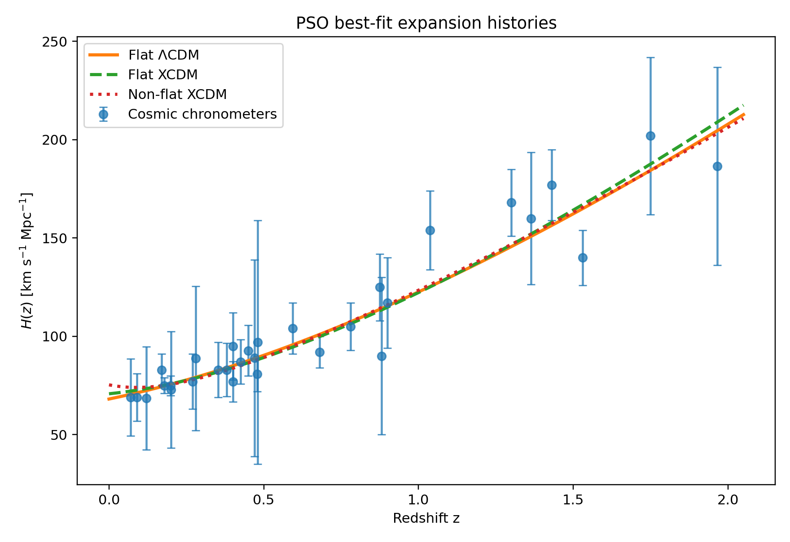
  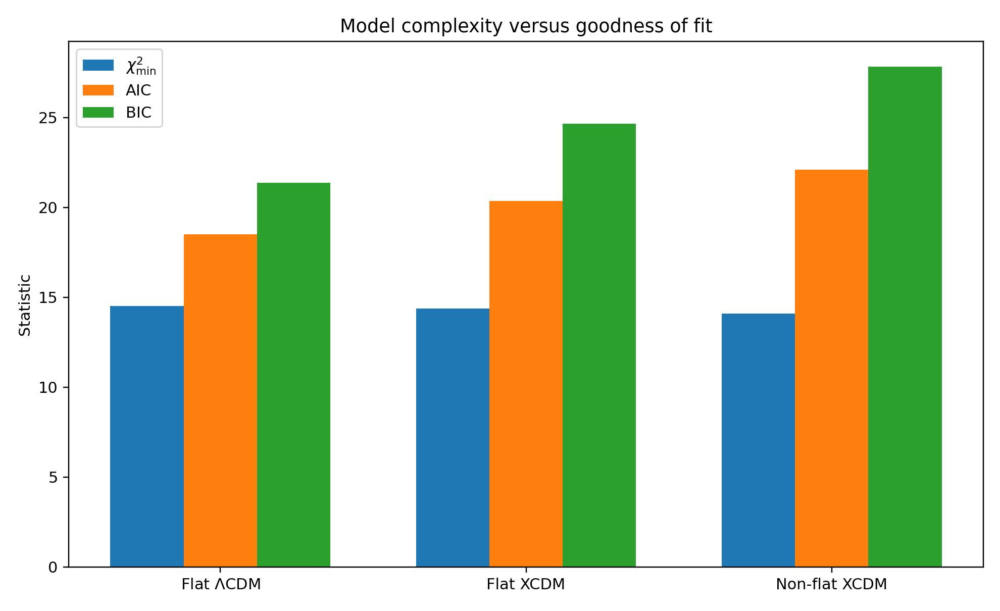
</p>

## Particle swarm optimizer

For particle $i$, the implementation uses

$$
\mathbf{v}_i^{(t+1)} =
\omega\mathbf{v}_i^{(t)}
+c_1\mathbf{r}_1\odot(\mathbf{p}_i-\mathbf{x}_i^{(t)})
+c_2\mathbf{r}_2\odot(\mathbf{g}-\mathbf{x}_i^{(t)}),
$$

followed by

$$
\mathbf{x}_i^{(t+1)}=\mathbf{x}_i^{(t)}+\mathbf{v}_i^{(t+1)}.
$$

Here $\mathbf{p}_i$ is the particle's personal-best position and $\mathbf{g}$ is the global-best position. Fixed NumPy random seeds make the production calculations deterministic. The optimizer is implemented in [`src/pso_cosmology/pso.py`](src/pso_cosmology/pso.py), independently of the cosmological model definitions.

## Repository structure

```text
data/                       31-point cosmic-chronometer data set
src/pso_cosmology/          PSO engine, cosmological models, statistics
notebooks/                  PSO mechanics plus three cosmology analysis notebooks
figures/                    selected full-resolution results
scripts/                    environment, notebook, and reference checks
tests/                      basic cosmology-model consistency tests
```

The notebooks are organized as:

0. [`00_pso_mechanics.ipynb`](notebooks/00_pso_mechanics.ipynb) — candidate universes, `pbest`/`gbest`, one-step movement, iteration snapshots, and convergence diagnostics.
1. [`01_flat_lcdm.ipynb`](notebooks/01_flat_lcdm.ipynb) — flat $\Lambda$CDM, the $\chi^2$ landscape, convergence, and swarm trajectories.
2. [`02_curvature_comparison.ipynb`](notebooks/02_curvature_comparison.ipynb) — flat versus non-flat $\Lambda$CDM and AIC/BIC comparison.
3. [`03_xcdm.ipynb`](notebooks/03_xcdm.ipynb) — flat and non-flat XCDM parameter-space exploration.

Detailed production settings and numerical reference values are recorded in [`REPRODUCIBILITY.md`](REPRODUCIBILITY.md) and [`RESULTS.md`](RESULTS.md).

## Reproducing the calculations

A Python 3.12 environment is recommended. With Conda:

```bash
conda env create -f environment.yml
conda activate pso-cosmology
```

If an existing `pso-cosmology` environment is being reused with a newly extracted checkout, refresh the local editable install and development requirements:

```bash
python -m pip install -e .
python -m pip install -r requirements.txt
```

Verify the environment and data table:

```bash
python scripts/check_environment.py
python -m pytest -q
```

Reproduce the deterministic production optima:

```bash
python scripts/check_reference_results.py
```

Run a reduced notebook smoke test:

```bash
python scripts/run_notebooks.py --quick
```

Run all production calculations:

```bash
python scripts/run_notebooks.py
```

Fresh outputs are written under `results/` and do not overwrite the committed reference figures.

## Statistical scope

PSO is used here as a **best-fit optimizer**, not as a posterior sampler. The particle trajectories illustrate optimization dynamics and should not be interpreted as confidence regions or posterior samples. Bayesian uncertainties or posterior distributions require an additional inference calculation and are outside the scope of this repository.

## Data

The 31 $H(z)$ measurements follow the cosmic-chronometer compilation tabulated by Ryan, Doshi & Ratra (2018), *Monthly Notices of the Royal Astronomical Society* **480**, 759–767, DOI: `10.1093/mnras/sty1922`. Only the $H(z)$ measurements are used here; the BAO measurements from that work are not part of this project. See [`DATA.md`](DATA.md) for provenance and units.

## Author

Allanur Ansari

## License

Code in this repository is released under the MIT License. The observational measurements retain the attribution of their original publications; see [`DATA.md`](DATA.md).
